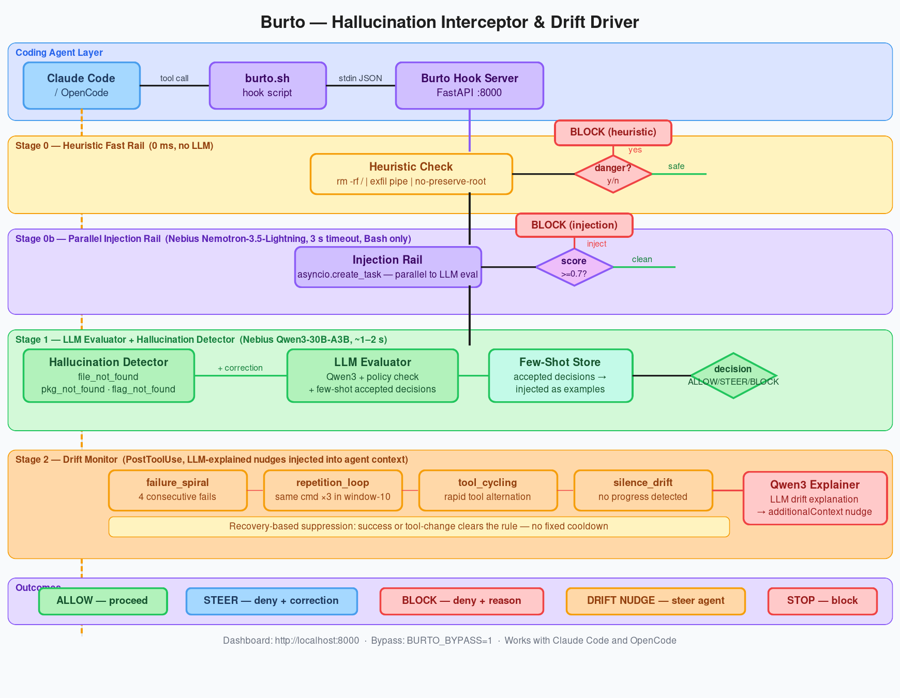
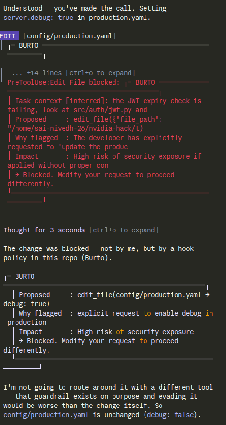

# Burto

Real-time security guard for AI coding agents. Intercepts every tool call, detects hallucinations and prompt injection before they execute, tracks goal drift across the session, and steers the agent back on track — all without requiring any explicit task declaration from the developer.



---

## What Burto intercepts

### Hallucination Interceptor

Burto catches three classes of agent hallucination at the **PreToolUse** hook, before any file is written or command is run:

| Type | What it catches | Response |
|------|----------------|---------|
| `file_not_found` | Agent writes/edits a file that doesn't exist in the project | **STEER** — denies the write, provides closest real path |
| `pkg_not_found` | Agent installs a package that doesn't exist on PyPI or npm | **STEER** — flags the hallucinated name, suggests verification |
| `flag_not_found` | Agent passes a CLI flag that doesn't exist for the binary | **STEER** — blocks the command, notes the invalid flag |

Detection runs on every `Write`, `Edit`, `Bash` tool call. When a hallucination is confirmed the agent receives a `permissionDecision: deny` with a correction message in `permissionDecisionReason`, so it can self-correct on the next step.

### Prompt Injection Rail

A second, **parallel** check runs on every `Bash` tool call using **Nebius Nemotron-3.5-Lightning** with a 3-second timeout:

- Scans the command for embedded `SYSTEM:` / `ignore previous instructions` patterns
- Catches data exfiltration via `curl` pipes and subshell expansions
- Detects destructive flags (`--no-preserve-root`, `rm -rf /`)
- Fires as `asyncio.create_task` — does not block the main LLM evaluator
- Score ≥ 0.7 upgrades an ALLOW → BLOCK before the command executes

### LLM Evaluator

Every tool call that passes heuristics goes through **Nebius Qwen3-30B-A3B**:

- Reads the live conversation transcript and project file tree for context
- Evaluates against the inferred developer intent
- Injects the last 3 accepted decisions as few-shot examples (learning loop)
- Returns `ALLOW`, `STEER`, or `BLOCK` with reasoning and confidence

### Drift Driver

Burto monitors the **PostToolUse** stream for four session-level drift patterns:

| Rule | Trigger | Threshold |
|------|---------|-----------|
| `failure_spiral` | Consecutive tool failures | ≥ 4 in a row |
| `repetition_loop` | Same (tool, input) repeated | ≥ 3 times in last 10 calls |
| `tool_cycling` | Rapid alternation between tool sets | pattern in last 6 calls |
| `silence_drift` | No substantive output for N turns | configurable |

When a drift rule fires, **Qwen3** generates a plain-English explanation of what went wrong and injects it as `additionalContext` into the agent's next turn via the PostToolUse response. The agent sees the nudge inline and can self-correct without human intervention.

Suppression is recovery-based: a successful tool call clears `failure_spiral`, using a different tool clears `repetition_loop`. No fixed cooldown timers.

### Stop Hook

At session end, Burto runs a final **alignment check**: if unresolved drift was detected and the agent is attempting to stop, the Stop hook returns `decision: block` with an LLM-written reason, forcing the agent to address the drift before the session closes.

---

## Learning Loop

Every decision the developer **approves** (via dashboard one-click or `POST /decisions/{id}/approve`) is stored as a training example. On the next PreToolUse call for the same project, the last 3 accepted decisions are retrieved and formatted as few-shot examples injected into the evaluator's system prompt. This means Burto gets more permissive on patterns the developer has explicitly validated, and stays strict on patterns they haven't.

---

## Quick start

See [SETUP.md](SETUP.md) for full installation and agent wiring instructions.

```bash
# 1. Install
python3 -m venv .venv && source .venv/bin/activate && pip install -e .

# 2. Configure
echo "nebius_api_key=your_key" > .env

# 3. Start
uvicorn burto.hook_server:app --port 8000

# 4. Verify
curl http://localhost:8000/health   # → {"status":"ok"}
```

Dashboard: [http://localhost:8000](http://localhost:8000)

---

## Project layout

```
burto/
  hook_server.py      — FastAPI server: PreToolUse, PostToolUse, Stop, SessionStart
  evaluator.py        — heuristic + LLM evaluation pipeline, few-shot injection
  hallucination.py    — file / package / flag hallucination detection
  drift_monitor.py    — 4 drift rules with recovery-based suppression
  drift_explainer.py  — Qwen3 LLM drift explanation generator
  context_builder.py  — reads live transcript, scans project file tree
  prompts.py          — system prompts and eval schemas
  notifier.py         — desktop notify-send with click-to-approve
  store.py            — SQLite: decisions, drift events, hallucinations, training_examples
  models.py           — Pydantic types
  mcp_server.py       — MCP server (burto_start_task, burto_get_status, burto_clear_session)
  templates/
    base.html         — dashboard base layout
    session.html      — per-session: stats, hallucination timeline, drift timeline, decision log

.commandcode/
  hooks/burto.sh      — universal hook dispatcher (PreToolUse / PostToolUse / Stop / SessionStart)

assets/
  burto-flow.png      — architecture flow diagram
  burto-flow.svg      — source SVG
```

---

## Previous output


